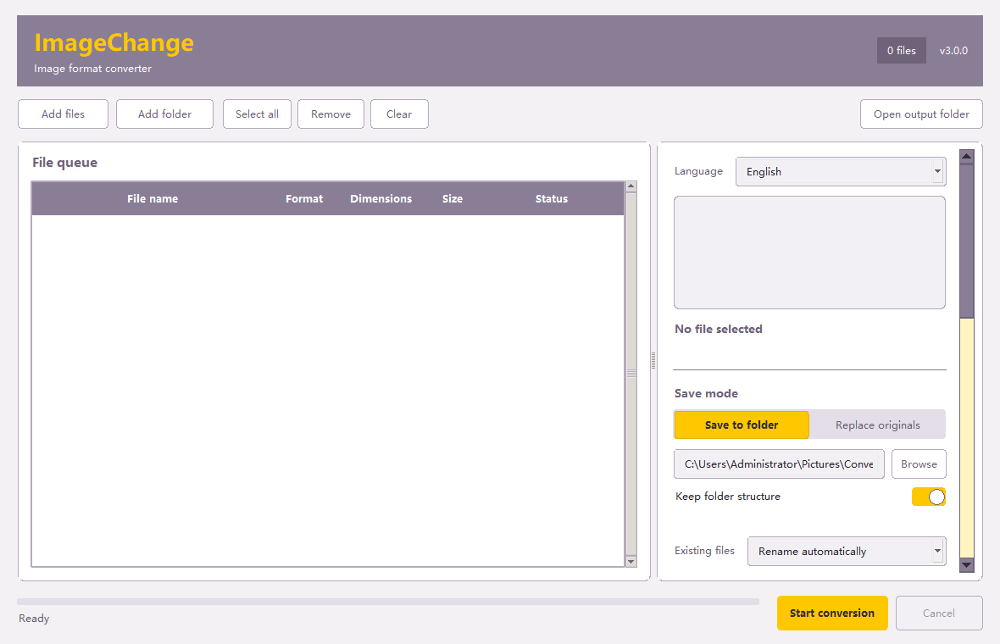

# ImageChange

ImageChange is a local Windows image converter built with Python, Tkinter, Pillow, and PDFium. It supports batch image conversion, PDF-to-image rendering, resizing, quality controls, safe output handling, and offline AI super resolution.

[简体中文](README.zh-CN.md)



## Highlights

- Switch between Chinese and English in the app; Chinese is the default.
- Import individual images, PDFs, or folders, including drag and drop.
- Export JPG, PNG, WEBP, BMP, TIFF, GIF, ICO, and PDF.
- Render all PDF pages, the first page, or a page range at 96-400 DPI.
- Preserve original PDFs and protect image replacement with confirmation and rollback.
- Resize by fitting, filling and cropping, or stretching to exact dimensions.
- Run fully offline. Files and paths are never uploaded.

## Feature preview

### Chinese and English interface

Switch languages without losing the current file queue or conversion settings. Chinese remains the default, and the selected language is remembered.


### PDF page rendering

Choose a rendering resolution and export every page, the first page, or a page range such as `1-3,5,8`.


### Batch conversion results

Process images and PDFs in one queue while tracking the result and size change for each file.


## Download

Download `ImageChange-3.0.0-win64.zip` from the GitHub Release. Keep `ImageChange.exe` and the `tools` folder together after extraction.

The executable is not code-signed, so Windows may show an unknown publisher warning.

## Run from source

```powershell
python -m venv .venv
.\.venv\Scripts\Activate.ps1
pip install -r requirements.txt
python .\src\app.py
```

## Test

```powershell
$env:PYTHONPATH="$PWD\src"
python -m unittest discover -s tests
```

## Build

```powershell
.\build-release.ps1 -Python ".\.venv\Scripts\python.exe"
```

The build includes PDFium and the local Real-ESRGAN ncnn Vulkan files required by the packaged application.

## License

ImageChange source code is released under the [MIT License](LICENSE). Bundled third-party components retain their own licenses; see the license files under `tools/`.
