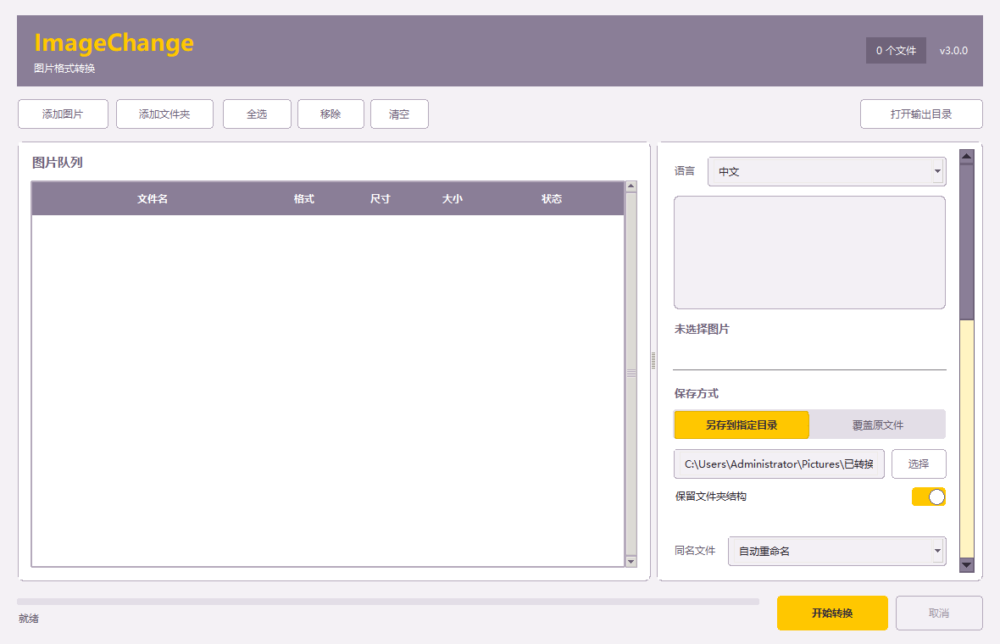
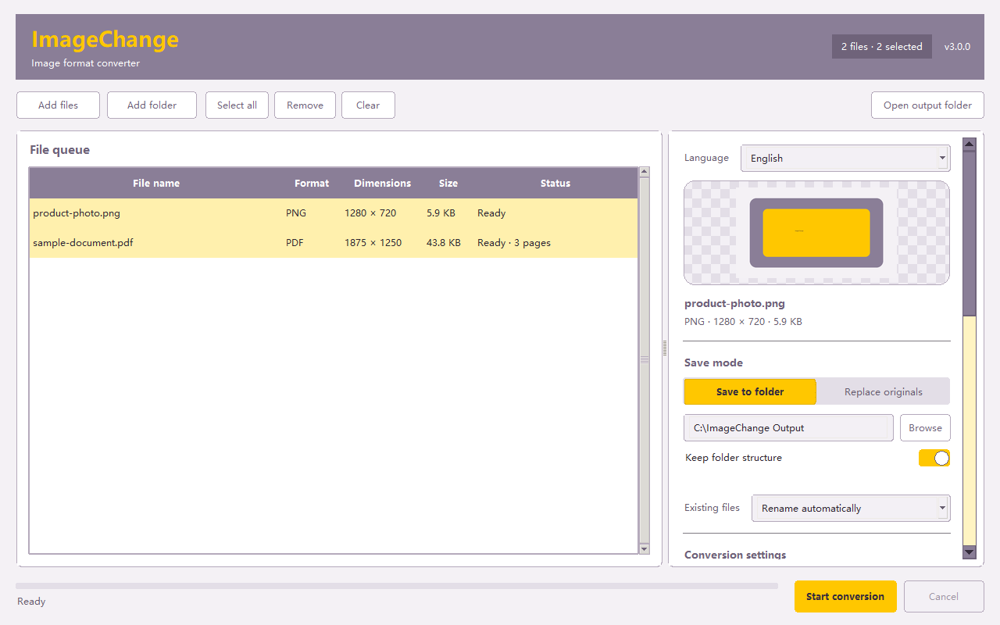
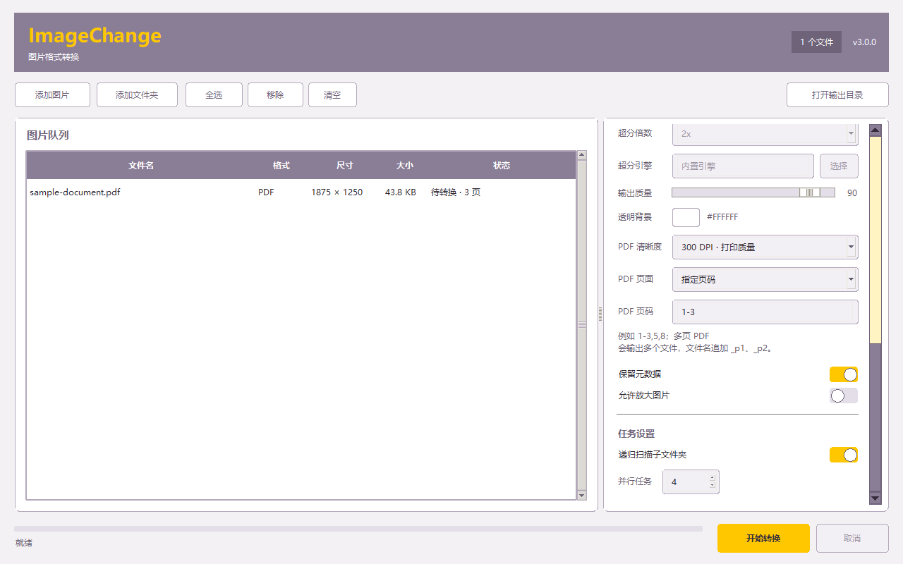
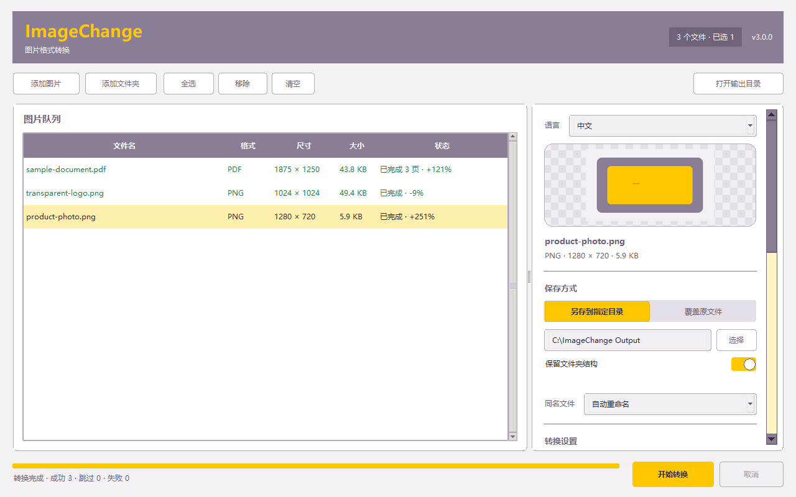

# ImageChange

ImageChange 是一款完全本地运行的 Windows 图片格式转换器，基于 Python、Tkinter、Pillow 和 PDFium，支持批量图片转换、PDF 转图像、尺寸调整、质量控制、安全输出和离线 AI 超分辨率。

[English](README.md)



## 主要功能

- 默认中文，可在设置区即时切换英文，并记住语言偏好。
- 支持选择图片、PDF、文件夹和拖拽导入。
- 支持 JPG、PNG、WEBP、BMP、TIFF、GIF、ICO 和 PDF 输出。
- PDF 可导出全部页面、首页或指定页码，支持 96-400 DPI。
- 原始 PDF 始终保留；图片覆盖带二次确认、冲突保护和失败回滚。
- 支持适应边界、填充裁切和拉伸到指定尺寸。
- 全程离线，不上传文件或路径。

## 功能预览

### 中英文界面

切换语言时不会丢失当前文件队列或转换设置。程序默认使用中文，并会记住上次选择的语言。



### PDF 页面转换

可以选择渲染清晰度，并导出全部页面、仅首页或 `1-3,5,8` 形式的指定页码。



### 批量转换结果

图片和 PDF 可以进入同一个任务队列，完成后逐项显示转换结果和体积变化。



## 下载与运行

从 GitHub Release 下载 `ImageChange-3.0.0-win64.zip`，解压后保持 `ImageChange.exe` 与 `tools` 文件夹位于同一目录。

当前 EXE 未使用商业代码签名证书，Windows 可能提示“未知发布者”。

## 源码运行

```powershell
python -m venv .venv
.\.venv\Scripts\Activate.ps1
pip install -r requirements.txt
python .\src\app.py
```

## 测试

```powershell
$env:PYTHONPATH="$PWD\src"
python -m unittest discover -s tests
```

## 许可证

ImageChange 源码采用 [MIT License](LICENSE)。随包提供的第三方组件继续适用各自的许可证，详见 `tools/` 中的许可证文件。
